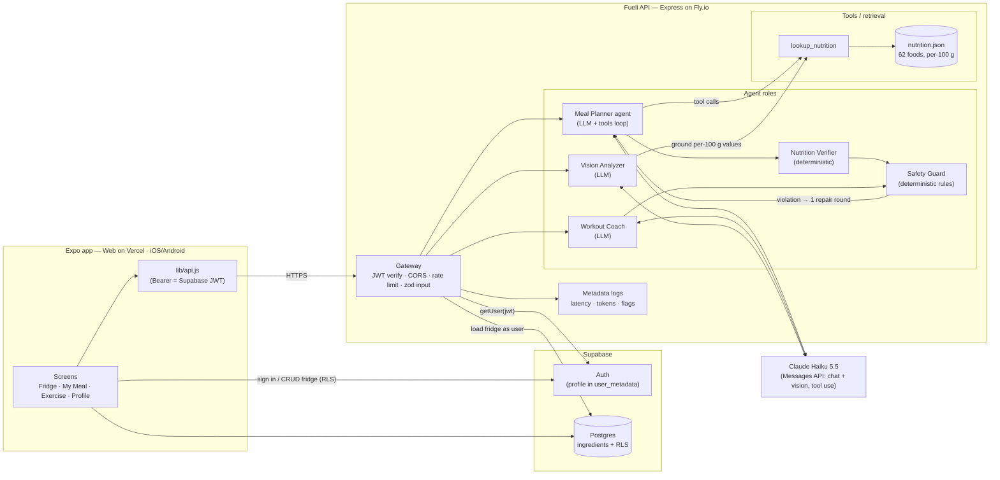

# Fueli — System Architecture

## Components

| Layer | What | Where |
|---|---|---|
| **UI** | Expo SDK 54 / React Native, exported as a static SPA for the web (`expo export -p web`) and hosted on Vercel. The same code runs on iOS/Android via Expo. | `App.js`, `screens/`, `vercel.json` |
| **Auth & data** | Supabase Auth (email/password; profile stored in `user_metadata`) and Postgres `ingredients` table protected by RLS. Meal/workout history currently lives in device storage. | `lib/supabase.js`, `supabase/migrations/` |
| **API gateway** | Express 5 on Fly.io: verifies the Supabase JWT, creates a per-request Supabase client *as the user*, enforces the CORS allow-list, rate limit and zod request schemas. | `server/src/index.js`, `auth.js`, `rateLimit.js` |
| **Model** | Anthropic Claude Haiku 5.5 (`claude-haiku-5-5`, set by `ANTHROPIC_MODEL`) via the Messages API with tool use, low effort, and zod-validated JSON; all output in English. Swappable in one file. | `server/src/llm.js` |
| **Data / retrieval** | Local nutrition knowledge base (USDA-derived per-100 g values, aliases, piece weights) with fuzzy name matching and unit→gram conversion. | `server/src/data/nutrition.json`, `tools/nutrition.js` |
| **Context** | The planner receives a compact profile view and pulls the fridge through a tool. All user-controlled text is wrapped in `<user_data>` blocks with an explicit "data, not instructions" rule. | `guard.js`, `agents/mealPlanner.js` |
| **Tools** | `lookup_nutrition` (KB, read-only). The fridge inventory is loaded from Supabase server-side and included in the prompt. The model has **no write tools**; fridge changes happen only when the user taps "cooked". | `tools/` |
| **Skills (Claude Code)** | `run-evals`, `deploy-fueli`: reusable workflows used while building. | `.claude/skills/` |
| **Agent / subagent roles** | Runtime: Planner (LLM), Nutrition Verifier, Safety Guard, Workout Coach, Vision Analyzer. Dev-time Claude Code subagents: `nutrition-auditor`, `safety-reviewer`. | `server/src/agents/`, `.claude/agents/` |
| **Evaluation** | 17 cases across 3 suites, automated rubric, JSON + Markdown reports. | `eval/` |

## Meal-plan request lifecycle
1. Client → `POST /v1/meals/suggest {neededTypes}` with the user's JWT.
2. Gateway verifies the JWT, loads the fridge (≤ 80 items, soonest expiry first) under RLS, and reads the profile from auth metadata.
3. Planner loop: the fridge is in the prompt; the model calls `lookup_nutrition([...])`, then returns final JSON (validated by zod, with one retry).
4. Verifier: macros recomputed from the KB when coverage ≥ 70%; missing ingredients and fridge utilization recomputed.
5. Guard: diet violations trigger one repair call; anything still violating is dropped and reported.
6. Response `{meals, blocked}`. One metadata log line is written.

## Why this split
- **Vercel** serves static assets from a CDN, which suits an exported Expo SPA, with preview deploys per branch.
- **Fly.io** runs a long-lived Node process. Agent loops take 10–25 s, beyond comfortable serverless limits; Fly keeps secrets server-side and scales to zero.
- **Deterministic code around the LLM:** the parts that must be correct (numbers for known foods, diet rules, state changes) are not left to the model.
