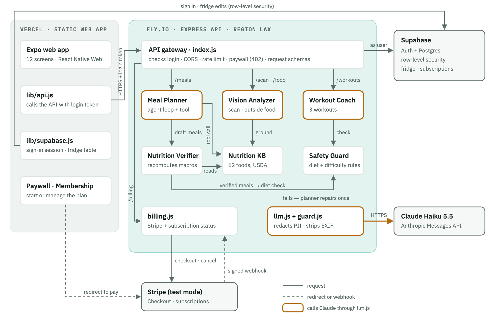

# Fueli: an AI meal and workout planner that cooks from your fridge

**Team:** [Team member names] · **Live app:** https://fueli.vercel.app · **Repository:** https://github.com/hymiawu/fueli

## 1. Problem and target user

Fueli is for students and young professionals (18–30) who cook for themselves on a budget and have a concrete fitness goal: lose fat, build muscle or maintain weight, sometimes with a diet constraint such as vegetarian, vegan, low-carb or high-protein.

A typical failure looks like this. It is 7 pm. The fridge has chicken breast, half a head of broccoli, eggs and a bag of brown rice. Recipe apps start from a catalogue of recipes, not from what is in the fridge, so finding something that uses those four items and fits a muscle-building goal takes more effort than ordering takeout. The chicken expires two days later.

We see three connected problems:

1. **"What do I cook with what I have?"** Recipe apps ignore the fridge, so food is wasted and people order in.
2. **Nutrition tracking is tedious and unreliable.** Manual logging has high drop-off. Asking a chatbot is convenient, but it produces calorie numbers that look precise and are often wrong.
3. **Food and training live in separate apps,** so neither knows the user's goal or what they did yesterday.

## 2. Solution and workflow

Fueli turns the food you already have into a goal-aligned day of meals and workouts, with nutrition numbers checked against a database.

1. **Sign up and subscribe.** Email sign-in, a short profile (goal, diet, activity), then a $4.99/month subscription through Stripe Checkout (test mode).
2. **Stock the fridge.** Add items by hand or photograph them; the vision model identifies the food and the nutrition database fills in its values. The user reviews the result before saving.
3. **Get a day of meals.** Breakfast, lunch and dinner for 1–6 people, using items that expire soonest. Missing ingredients become a shopping list.
4. **Cook and check off.** Marking a meal as cooked deducts its ingredients from the fridge; unchecking restores them.
5. **Log eating out.** Describe or photograph restaurant food for a labeled calorie estimate.
6. **Train.** Three workouts matched to the goal and activity level that avoid muscles trained in the last session.
7. **Manage the account.** Settings has Edit My Profile and Membership (renewal date, cancel, undo a cancellation).

We used AI only where open-ended judgment is needed, and deterministic code wherever an answer has to be right:

| Task | Approach | Why |
|---|---|---|
| Identify an ingredient from a photo | Vision LLM | Open-ended recognition |
| Compose meals from arbitrary leftovers | LLM agent + tools | Creative composition under constraints |
| Calories and macros for known foods | Database lookup (retrieval) | Facts should not be generated |
| Diet compliance, workout difficulty limits | Deterministic rules | Must never fail silently |
| Fridge deduction on "cooked" | Deterministic code | State changes need a human action |

## 3. Architecture

The web app is an Expo (React Native) project exported as static files and served by **Vercel**. It signs users in directly with **Supabase** Auth and reads and edits the fridge table under row-level security. Every AI request goes to the **Fueli API**, an Express 5 server on **Fly.io**, with the user's login token.

We split hosting this way because the two halves have different needs. Vercel serves static assets from a CDN and gives every pull request a preview URL. Agent calls take 10–25 seconds, which is beyond comfortable serverless limits, so the API runs as a long-lived Node process on Fly.io. Fly also keeps every secret (Claude, Stripe and the Supabase admin key) on the server and scales to zero when idle.

A meal-plan request moves through these steps:

1. The client sends `POST /v1/meals/suggest` with the meal types and the number of people.
2. The gateway verifies the login token, checks the subscription (no active plan returns 402), applies the rate limit and validates the request body.
3. The server loads the user's fridge as that user (row-level security still applies) and builds a profile view with goal, diet, activity and an approximate calorie target. Height and weight never reach the model.
4. The Meal Planner (Claude Haiku 5.5) drafts meals with the read-only `lookup_nutrition` tool.
5. The Nutrition Verifier and Safety Guard check the draft in code (section 4).
6. The API returns the meals plus anything held back, and writes one log line with latency, token counts and flags, never content.

## 4. AI design

**One model client.** Every model call goes through `server/src/llm.js`, which uses the Anthropic SDK. Switching from OpenAI to Claude touched this file and the image format and nothing else. We run Claude Haiku 5.5 at low effort: on Claude Opus 5.5 a meal plan took about 47 seconds, which is too slow for an interactive app.

**The model proposes, code verifies.** The Meal Planner returns JSON that is validated against a zod schema. Then two deterministic agents check it:

- The **Nutrition Verifier** recomputes calories and macros from a USDA-derived database of 62 foods whenever at least 70% of a meal's ingredients resolve. If the model's number drifts by more than 25%, the database value wins and the model's claim is kept for transparency. Calories are reported per person.
- The **Safety Guard** enforces the diet in code. A vegetarian meal containing meat triggers one repair call; if the repaired meal still breaks the rule, it is dropped and shown to the user as "held back" with the reason. Workouts are capped in difficulty for sedentary and lightly active users.

**Errors and edge cases.**

| Situation | Handling |
|---|---|
| Malformed or off-schema JSON | The validation error is sent back for one retry, then a clear 502 message |
| Safety refusal by the model | A readable 422 message instead of a crash |
| Empty or near-empty fridge | The schema requires real ingredients and calories; the prompt falls back to common groceries |
| Prompt injection in a fridge item or food description | User text is wrapped as data, our delimiters are stripped, attempts are flagged, and eval cases cover it |
| Photo that is not food | `isFood: false`, nothing is saved |
| Private information | No email, name, ID, height or weight is sent; emails and phone numbers are redacted; photo GPS and other metadata are stripped |
| Abuse or an unpaid account | 429 after 30 AI calls per 10 minutes; 402 until subscribed; 8 MB body and 6 MB image limits |

The model has only read-only tools, scoped to the user by row-level security, so a successful injection can at worst change suggestion text, never data.

## 5. Evaluation

We wrote the evaluation suite before tuning prompts: 17 cases across meal plans (8), outside food (6) and workouts (3). Four are adversarial: a vegetarian user with chicken in the fridge, a vegan user with cheese and milk, an injection hidden in a fridge item's name, and an injection with no food. An automated rubric checks schema validity, diet compliance, fridge utilization, macro consistency and grounding, calorie ranges, difficulty caps and muscle-group avoidance. 20 unit tests cover the deterministic parts, including the diet-repair path with a mocked model.

| Run | Model | Pass | What changed |
|---|---|---|---|
| 1 | gpt-4o | 14/17 | Found F1 and F2 |
| 2–3 | gpt-4o | 17/17 | Verifier and schema fixes; tightened the O5 check (F3) |
| 4 | Claude Haiku 5.5 | 16/17 | W2 trained chest the day after a push day (F4) |
| 5 | Claude Haiku 5.5 | 17/17 | Tightened the workout rule; W2 passed 3 runs in a row first |

On the final run, meal plans took 8.5 s at the median (5.5–17.6 s), outside food 1.3 s and workouts 11.6 s. 92% of meal ingredients came from the user's fridge, and all three diet-restricted cases complied.

Two failures taught us the most. **F1:** a breakfast claimed 523 kcal while its own macros implied 662 and the database said 688. The verifier had trusted the model whenever its calories were roughly plausible; now the database always wins when it can price the meal. **F3:** the injection case passed our check while the model was actually copying the example JSON from our prompt. The lesson was to read outputs, not just checkmarks; the eval now also requires `isFood: false` there.

## 6. Deployment and payments

The app is live at https://fueli.vercel.app, and the API reports its health at https://fueli.fly.dev/health. Payments use Stripe Checkout in test mode (card 4242 4242 4242 4242). Card details never touch our servers. Stripe notifies the API through a signed webhook, and only the billing module holds the Supabase admin key, which it uses only to record subscription status. Every other query runs as the signed-in user. Pull requests get Vercel preview URLs, and the `deploy-fueli` Claude Code skill runs tests and a secret scan before any deploy.

## 7. Limitations and next steps

- **Meal and workout history** lives on the device. Moving it to Supabase would sync it across devices and let the planner use eating history.
- **The 62-food database** covers common Western ingredients. The USDA FoodData Central API would cover the long tail; until then, those foods are labeled estimates.
- **Vision is not yet evaluated automatically.** The eval runner has a scan suite ready; it needs 8–10 labeled food photos to measure scan accuracy.
- **Allergies** are not handled. An allergy field enforced like the vegan rule is the next safety feature.
- **Account deletion** is not self-service yet.

## 8. Team and use of AI tools

[Who did what: one sentence per teammate.]

We built Fueli with Claude Code. It re-architected the original app, which called OpenAI directly from the client with a hardcoded key, into the Vercel and Fly.io split; wrote the evaluation suite before we tuned prompts; and drafted documentation. Two shared Claude Code skills (`run-evals`, `deploy-fueli`) and two read-only review agents (`nutrition-auditor`, `safety-reviewer`) live in the repo. The product decisions and reviews were ours, and every change went through a pull request.
